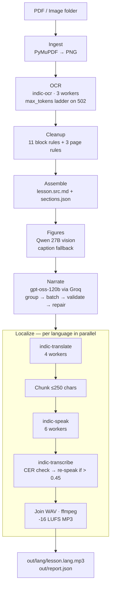
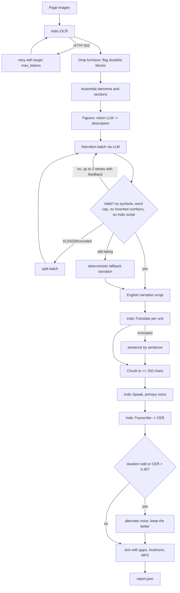

# Scanned Chapter to Translated, Narrated Audio Lesson

An automated pipeline that converts scanned textbook pages (PDF or page images) into structured English lesson notes and translated, teacher-style narrated MP3 audio across Indian languages.

Core pipeline rule: all OCR, translation, speech synthesis, and speech recognition use Bodhan models only (`indic-ocr`, `indic-translate`, `indic-speak`, `indic-transcribe`). An external LLM is strictly confined to English pedagogical narration and diagram comprehension; it is programmatically barred from generating Indian-language text.

## Summary

This project implements an automated, agentic pipeline that transforms scanned textbook chapters—containing complex geometry diagrams, LaTeX equations, and multi-page layouts—into pedagogical, multilingual narrated audio lessons across Indian languages. 

Visual document extraction, translation, speech synthesis, and audio verification are handled exclusively by Bodhan Indic foundation models (`indic-ocr`, `indic-translate`, `indic-speak`, `indic-transcribe`), while general-purpose models (`gpt-oss-120b` via Groq free tier and Qwen 27B) are strictly constrained to English pedagogical planning, diagram comprehension, and conversational narration. The system deterministically repairs OCR layout noise, translates dense mathematical notation into natural spoken words, relocates visual descriptions to their exact point of textual reference, and enforces an automated closed-loop quality audit where synthesized audio is back-transcribed to detect and re-speak anomalous chunks before final mastering into loudness-normalized (-16 LUFS) MP3 lessons.

## How to run

### Prerequisites
- **Python**: 3.10 or higher
- **ffmpeg**: Must be installed and accessible on `PATH` (used for audio loudness normalization and MP3 mastering).
- *(Note: Page rendering uses PyMuPDF; `poppler` is not required.)*

---

### Step 1 · Set up Virtual Environment

```bash
# Clone the repository and navigate into it
git clone https://github.com/SHRIYAASK/bodhan_scannedbook_to_mp3.git
cd bodhan_scannedbook_to_mp3

# Create and activate a virtual environment
python -m venv .venv

# On Linux/macOS:
source .venv/bin/activate

# On Windows (PowerShell):
.venv\Scripts\Activate.ps1
```

---

### Step 2 · Install Dependencies

```bash
pip install -r requirements.txt
pip install -e .
```

---

### Step 3 · Configure API Keys

Copy the environment template and configure your credentials:

```bash
cp .env.example .env
```

| Key | Purpose | Required? | Demo Configuration |
|---|---|---|---|
| `BODHAN_OCR_KEY` | Bodhan `indic-ocr` API access | **Yes** | Bodhan Console API Key |
| `BODHAN_TRANSLATE_KEY` | Bodhan `indic-translate` API access | **Yes** | Bodhan Console API Key |
| `BODHAN_SPEAK_KEY` | Bodhan `indic-speak` TTS API access | **Yes** | Bodhan Console API Key |
| `BODHAN_TRANSCRIBE_KEY` | Bodhan `indic-transcribe` ASR for CER check | Optional | Skips back-check verification if omitted |
| `LLM_BASE_URL` | OpenAI-compatible endpoint URL | **Yes** | `https://api.groq.com/openai/v1` |
| `LLM_API_KEY` | API Key for LLM provider | **Yes** | Groq API Key |
| `LLM_MODEL` | Model for English narration | **Yes** | `gpt-oss-120b` (Groq free tier) |
| `LLM_VISION_MODEL` | Vision model for figure descriptions | Optional | `Qwen 27B` (falls back to caption if unset) |
| `LLM_EXERCISE_MODEL` | Model for exercise hint planning | Optional | Defaults to `LLM_MODEL` if unset |

---

### Step 4 · Run the Pipeline

Execute end-to-end processing for a scanned PDF or folder of page images:

```bash
python -m bodhan_lesson --input chapter.pdf --out out --langs hi ta bn
```

#### Useful CLI Options

| Flag | Description | Typical Use Case |
|---|---|---|
| `--pages N` | Process only the first $N$ pages | Fast evaluation on long chapters (e.g. `--pages 10`) |
| `--from-script` | Skip OCR, Cleanup, and Narration; reuse `out/source/narration_script.en.json` | Resuming speech generation or adding languages without re-calling LLMs |
| `--no-llm` | Disable LLM calls; uses deterministic rule-based fallback narration | Offline/zero-cost testing without LLM API keys |
| `--no-audio` | Run through translation only; skips TTS and MP3 assembly | Fast text and translation validation |
| `--cache-dir` | Path for disk cache (default: `.bodhan_cache`) | Content-hashed disk cache ensures interrupted runs resume cheaply |

---

### Step 5 · Run Verification Tests

Run the 179-test automated test suite, including smoke tests on mocked APIs and compliance checks that reject banned non-Bodhan OCR/TTS libraries:

```bash
pip install -e .[dev]
pytest
```

<details>
<summary><b>Alternative: Run with Docker</b></summary>

```bash
docker build -t bodhan-lesson .
docker run --env-file .env -v "$PWD:/work" bodhan-lesson --input chapter.pdf --out out --langs hi ta bn
```
</details>

## Architecture



> `--from-script` skips stages 1–5b and enters at Localize · `--no-llm` bypasses LLM, uses rule-based fallback · `--no-audio` stops after translate

| Stage | Module | What it does |
|---|---|---|
| Ingest | `stages/ingest.py` | Renders pages to PNG at 150 DPI (PyMuPDF); accepts PDF or image folder; no embedded text layer is used |
| OCR | `stages/ocr.py` | Indic-OCR with 3 concurrent workers; `max_tokens` ladder 2048→4096→8192 on HTTP 502; raw JSON cached per page |
| Cleanup | `stages/cleanup/` | 11 deterministic block rules (reclassify equations, hyphenation, table detection, doubtful flags) + 3 page rules (drop furniture, crop figures, join page-break splits) |
| Assemble | `stages/assemble/` | `build_elements → join_split_tables → build_sections → _render`; outputs `lesson.src.md`, block map, and `sections.json` |
| Figures | `stages/figures.py` | Qwen 27B vision model describes each figure crop (2 concurrent workers, 2 retries, caption fallback) |
| Narrate | `stages/narrate/` | Figure placement → grouping → 1800-char batches → `gpt-oss-120b` (Groq) → `check_batch` validator → retry/split → `repair_batch` |
| Localize | `stages/localize.py` | Per-language parallel: translate pool (4 workers) → chunk ≤250 chars → speak+CER pool (6 workers) → WAV join → ffmpeg MP3 |

## Workflow



## Where the LLM is used, and why
| Decision | Model used | Fallback |
|---|---|---|
| Describe a figure from its crop and caption | Vision LLM (Qwen 27B model) | caption only |
| Write English narration for each batch of elements | `gpt-oss-120b` (Groq free tier) | rule-based narration (`narrate/fallback.py`) |
| Exercise "how to solve" hints (separate prompt, three sentences, never states the answer) | `gpt-oss-120b` (Groq free tier) | rule-based |

Guards, enforced in code: LLM output containing any Indian-script character is rejected
(`IndicTextError`); images are sent only for figure crops; spoken numbers must come from the source group;
symbols and brackets are rejected so TTS never reads them.

## How tables, equations and figures are narrated
- **Equations** are spoken as words (`angle A O C equals angle B O D`), never as symbols.
- **Figures** are described from the crop, and placed after the first paragraph that cites them by number,
  not in sequence. Example: "Look at figure six point eight where lines A B and C D cross at O."
- **Tables** are summarised row by row from the OCR Markdown table, joined across pages where they continue.
  The demo pages contain no table; this path is covered by unit tests only.
- **Exercises:** "Problem one. Find angle B O E and reflex angle C O E. First, use vertically opposite
  angles to find angle A O C. Then use the given sum to find angle B O E, and finally use angles on a line."

## Bodhan models used
Hosted API (`https://api.bodhan.ai/v1`): `indic-ocr` (table format markdown), `indic-translate`
(`script: native`, `max_output_tokens`, truncation detected by `finish_reason`), `indic-speak` (voice by
language, `style: educational lecture`, chunks of at most 250 characters), `indic-transcribe` (per chunk,
under the 30 s limit).

## Results
Demo chapter: NCERT Class 9 Maths, Lines and Angles, **first 10 pages** processed (OCR cost limited the rest).

| | Hindi | Tamil | Bengali |
|---|---|---|---|
| Narration units | 72 | 72 | 72 |
| Audio chunks spoken | 117 of 117 | 141 of 141 | 118 of 118 |
| Audio length | about 27 min | about 29 min | about 30 min |
| Chunks back-transcribed (CER) | 53 of 117 | 59 of 141 | 53 of 118 |
| CER over those chunks | 0.114 | 0.082 | 0.082 |

- **Files:** `out/source/lesson.src.md`, `out/source/narration_script.en.md`; `out/<lang>/lesson.<lang>.mp3`,
  `out/<lang>/narration/<section>.<lang>.mp3`, `out/<lang>/narration_script.<lang>.json` (the exact TTS text,
  voices, durations, per-chunk transcript and CER); `out/report.json` (per-language counts, per-section CER,
  `timing_s`, `cost_estimate_inr`).
- **Per-section CER** is highest in the worked-example and exercise sections (Hindi 0.21 and 0.31, Tamil 0.31
  in the worst sections) and near zero in plain prose (0.002 to 0.03). Bengali achieved an overall CER of 0.082
  with strong fidelity across sections. I have not listened to those sections,
  so I cannot say how much is real audio error and how much is the transcriber's own noise; Indic-Speak's
  model card reports about 18% CER against its own back-transcription.
- **Why only about half the chunks have a CER:** the remaining Indic-Transcribe calls hit the API rate limit
  (HTTP 429) after five attempts. They are recorded as `check_error` per chunk, never silently skipped, and
  a rerun fills them from the cache.
- Bengali is fully produced (all 72 units translated, voice Ishita, CER 0.082). The Indian-language source chapter was **not produced**.
- Demo outputs are not committed (scans and large audio). Link: _to be added_.

## Demo video
[Watch Demo Video on Google Drive](https://drive.google.com/file/d/1B9DnD6PbLpDnt6r04mKb6nKAcag6tyRo/view?usp=sharing)

## Trade-offs and known limitations
What breaks or is missing today, stated plainly:
- **Back-check incomplete:** CER exists for about half of the Hindi, Tamil, and Bengali chunks (see Results).
  Chunks whose transcript is far from the text (CER above 0.45) or whose duration looks wrong are re-spoken
  with the alternate voice and the better take is kept, but this recovery has only been exercised on mocked
  responses plus the 5 chunks it flagged in the demo.
- **Runtime target not demonstrated.** The spec asks for 10 pages x 3 languages in under 20 minutes. I have no
  clean timed three-language run. Observed: the first Hindi run took about 27 minutes under heavy rate
  limiting (hundreds of 429 retries); a later run that reused cached translation and speech and only added the
  back-check took 461 s for two languages. Languages now run in parallel, translation and speech use shared
  pools with larger worker counts, and `report.json` records per-stage time, but the real bottleneck is
  Bodhan's rate limits, which the code can only back off from.
- **Tamil has 8 silent gaps** (8 of 141 chunks) and **Bengali has 3 silent gaps** (3 of 118 chunks), because API rate limits were hit mid-run. Rerunning
  `python -m bodhan_lesson --from-script --out out --langs <lang>` fills only those from the cache.
- **Only 10 of about 20 pages** of the demo chapter were processed; an Indian-language source chapter
  was not run.
- **Translated lesson Markdown (`lesson.<lang>.md`) is not produced**; only the narration is translated. The
  "structure survival" and "numbers and LaTeX in translations" checks are therefore not implemented. Numbers in
  the English narration are checked against the source; in the translation they are not.
- **Not built:** handwriting detection, Indian-language source chapters, glossary or terminology consistency,
  reading-order repair for multi-column pages, a self-hosted model option, per-sentence timestamps and chapter
  markers in the full-lesson MP3.
- **Known OCR quirks:** `\overline` is conflated for segment and ray; figure crops have loose padding; two
  doubtful equation blocks were skipped and logged rather than narrated.
- **Table narration** exists but the demo pages contain no table, so it is covered by unit tests only.
- **Environment:** developed and run on Windows with Git Bash and Python 3.12; Docker and Linux were not tried.

## AI assistance
Built with Claude Code (Claude Sonnet 5.5) and Antigravity for design, implementation and tests. 